# Génératrice d'éolienne surveillée par Arduino : boîtier SolidWorks, câblage et programme

🇫🇷 [Français](#français) · 🇬🇧 [English](#english)

**▶ Démo web / Web demo :** https://valentin-auger-laboratoire.github.io/portfolio/demos/eolienne/
Les montages 2024 et 2026 côte à côte sur le même vent : oscilloscope, relais, moniteurs série et puissance. / The 2024 and 2026 setups side by side on the same wind: oscilloscope, relays, serial monitors and power.

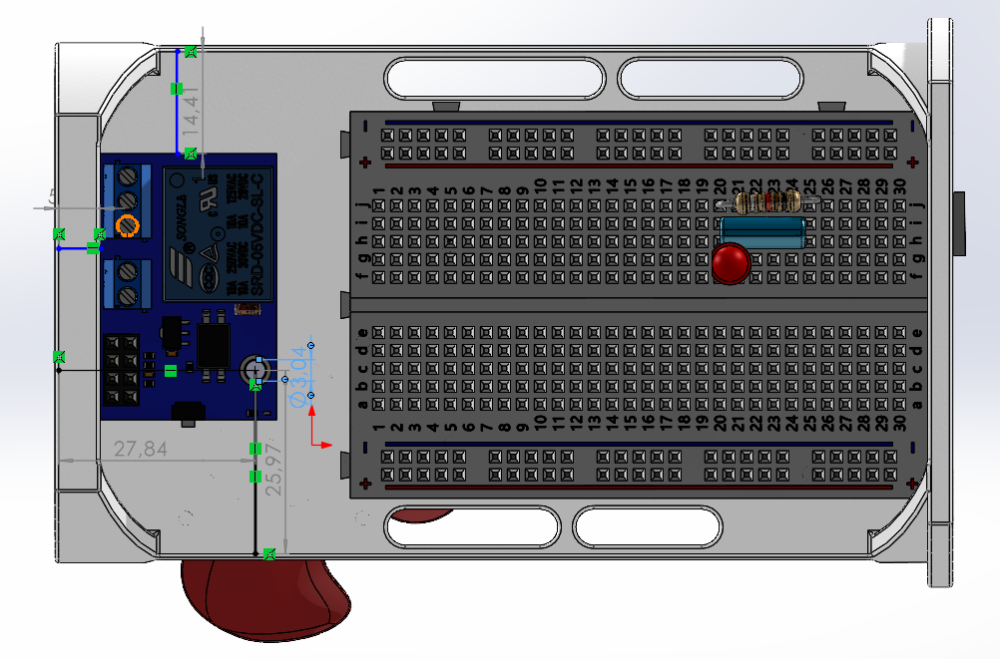

---

## Français

### Le besoin
Projet personnel de **CPGE TSI** (juillet 2024), autour de l'énergie éolienne. L'idée : une petite éolienne entraîne une génératrice à aimants et bobine, un Arduino **mesure la tension produite**, et quand elle est suffisante il **ferme un relais** qui allume une LED. La LED montre que l'éolienne produit assez d'énergie. Tout le montage, carte, relais et breadboard, tient dans **un boîtier** conçu sous SolidWorks.

### 1. Le boîtier (SolidWorks)
Je suis parti d'un boîtier existant, conçu pour un autre usage, dont j'aimais la forme. **Je l'ai entièrement remodelé** pour ce montage :
- les emplacements du **module relais** et de la **breadboard** (avec sa LED et sa résistance) ;
- les **trous de vis et les logements d'inserts**, placés en fonction de la position réelle de chaque composant ;
- la mise en position de chaque composant par des contraintes et des cotes dans l'assemblage.

| Breadboard mise en place (84,73 × 63,72 mm) | Trous de vis et d'inserts |
|---|---|
| 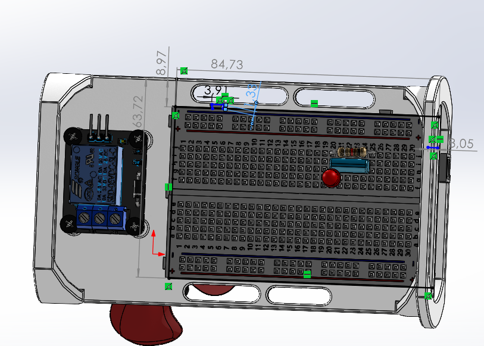 | 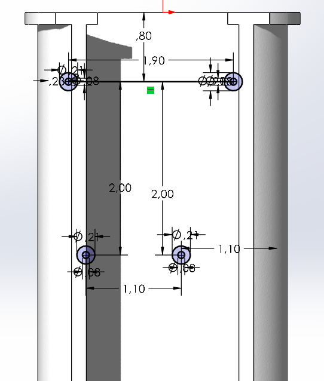 |

**Mise en position du module relais** : coté par rapport aux bords du boîtier (5,33 / 27,84 / 25,97 mm), avec son trou de fixation de Ø 3,04 mm aligné sur un insert.

| | |
|---|---|
|  | 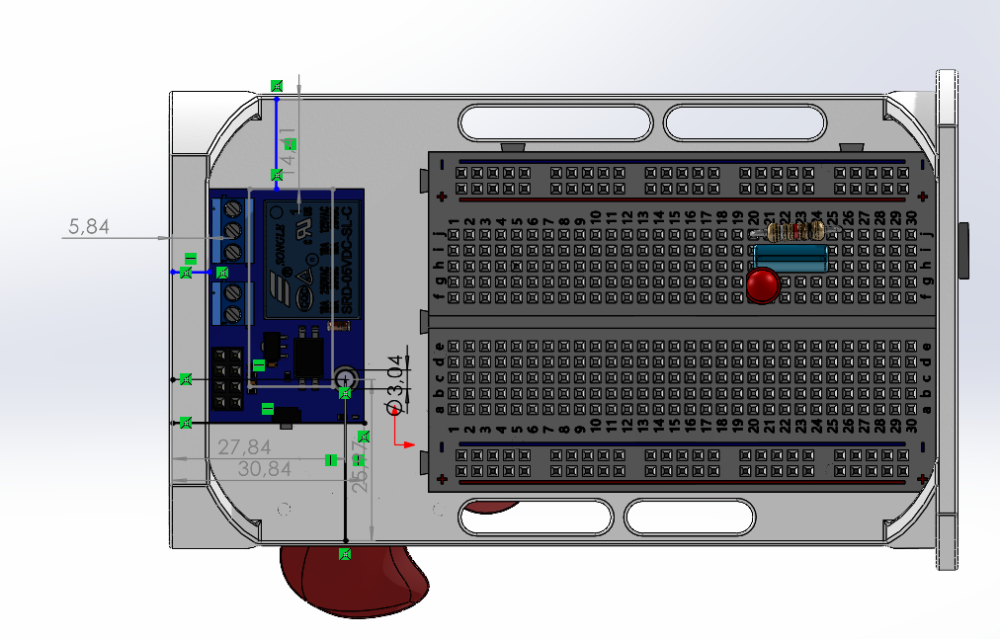 |
| 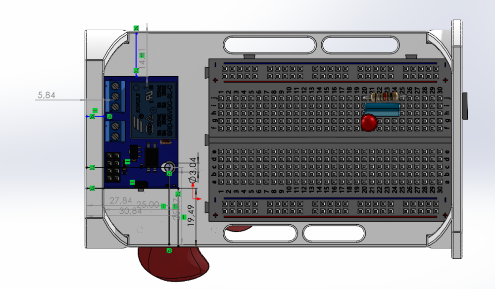 | 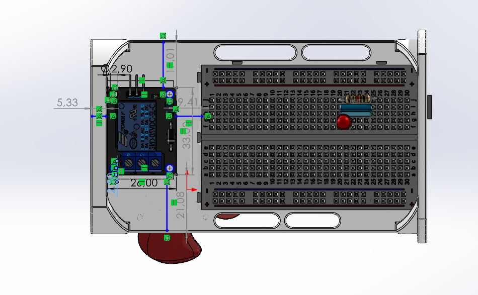 |

Le module relais, la breadboard, l'hélice et la mini-génératrice sont des **modèles 3D de composants du commerce**, utilisés pour vérifier l'encombrement. Le boîtier remodelé et l'assemblage sont mon travail.

### 2. Le câblage et le fonctionnement prévus en 2024

| Schéma de principe | Composants | Algorigramme |
|---|---|---|
| 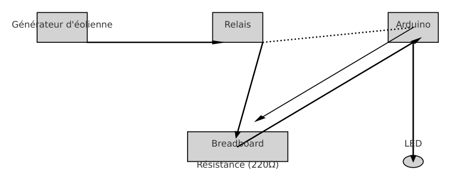 | 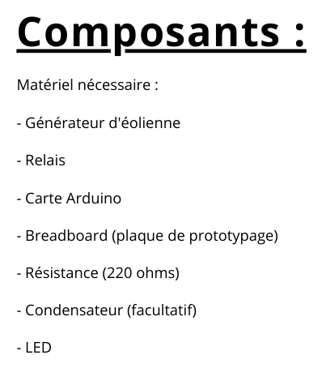 | 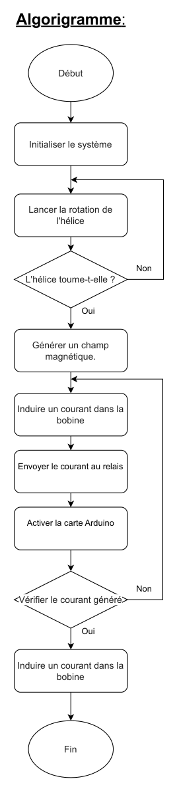 |

- **Génératrice** : sortie + sur **A0**, sortie − sur **GND**.
- **Module relais 1 voie** : commandé par **D8**.
- **LED rouge + résistance de 220 Ω** : branchée sur la sortie du relais.
- **Condensateur** : facultatif.

### 3. Le programme de 2024 : [`code/eolienne_2024`](code/eolienne_2024)
Le programme lit A0 toutes les 100 ms, affiche la valeur sur le moniteur série et ferme le relais quand la lecture dépasse **100 sur 1023** (environ 0,5 V). C'est une logique simple et lisible, qui correspond à l'algorigramme.

### 4. Version 2026 : un programme et un câblage qui fonctionnent sur un vrai montage
En reprenant le projet, j'ai relu le schéma et le code avec ce que je sais aujourd'hui, et j'ai **réécrit le programme** pour qu'il fonctionne avec une vraie génératrice : [`code/eolienne_2026`](code/eolienne_2026).

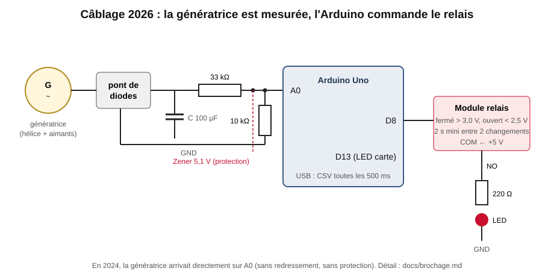

| Point | 2024 | 2026 |
|---|---|---|
| **Qui commande qui** | Le schéma fait passer le courant de la génératrice dans le relais pour « activer l'Arduino ». | La génératrice est **mesurée** par l'Arduino, et l'**Arduino commande le relais**. C'est déjà ce que fait le code de 2024 : le schéma est remis en accord avec lui. |
| **Protection de l'entrée A0** | Génératrice en direct sur A0. Une génératrice à aimants produit une tension **alternative** : les alternances négatives et les pointes au-dessus de 5 V sortent des limites de l'entrée. | **Pont de diodes**, condensateur de 100 µF, **pont diviseur 33 kΩ / 10 kΩ** (jusqu'à environ 21 V mesurables) et **diode Zener 5,1 V** de protection. |
| **Unité** | Valeur brute de 0 à 1023. | Conversion en **volts** (`× 5 / 1023 × 4,3`) et moyenne glissante sur 8 mesures. |
| **Seuil** | Un seul seuil : le relais claque à chaque rafale. | **Hystérésis** : fermé au-dessus de 3,0 V, ouvert sous 2,5 V, et **2 s minimum** entre deux changements. |
| **Boucle** | `delay(100)` | non bloquante (`millis()`), une mesure toutes les 50 ms |
| **LED** | Sur la sortie NO du relais : il faut aussi relier **COM au +5 V**. | Câblage précisé, et la LED de la carte (D13) recopie l'état du relais. |
| **Sortie série** | `Tension lue: 123` | CSV toutes les 500 ms (`t_ms,tension_V,moyenne_V,relais`), prêt à tracer |

Le détail des broches et des valeurs est dans [`docs/brochage.md`](docs/brochage.md).

### 5. Test : simulation des deux programmes
Le script [`simulation/simulation.py`](simulation/simulation.py) fait tourner les deux logiques sur le **même vent**, pendant 2 minutes : 5 m/s en moyenne, avec des rafales, et une génératrice alternative. Les hypothèses sont écrites en tête du script : ce sont des valeurs de simulation, pas des mesures.

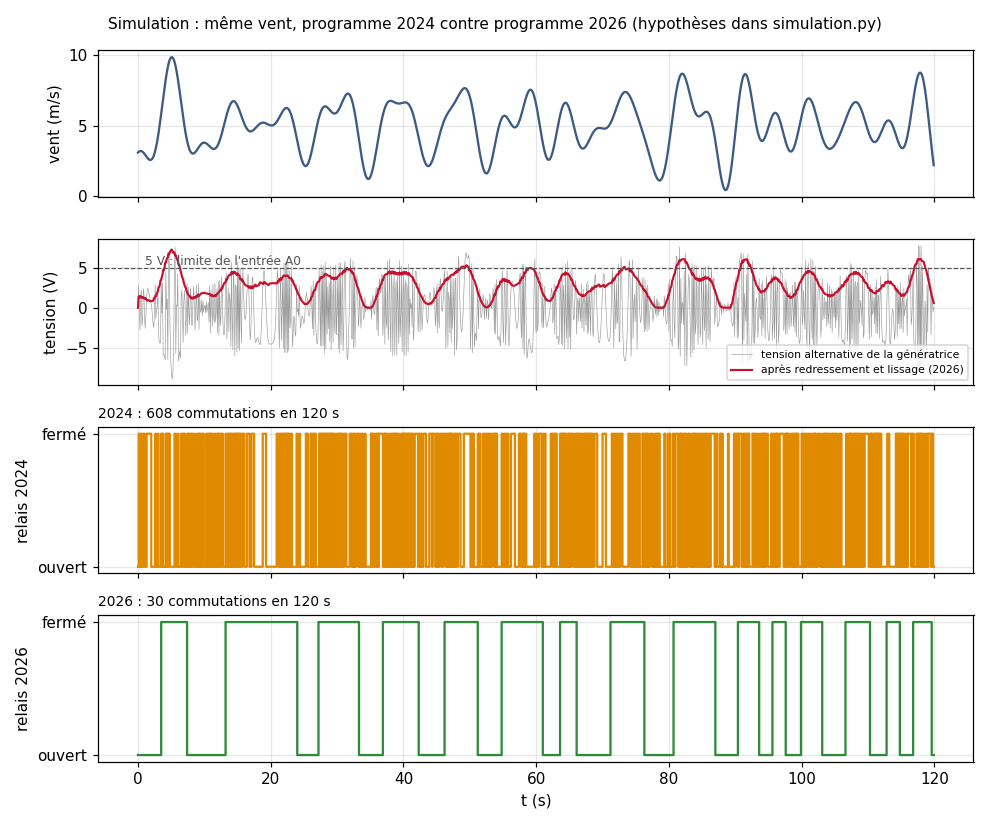

| Résultat sur 120 s | 2024 | 2026 |
|---|---|---|
| Commutations du relais | **608** (≈ 300 par minute) | **30** (15 par minute) |
| Tension au-dessus de 5 V sur A0 | **7 %** du temps | jamais (pont diviseur et Zener) |

Avec une tension alternative lue toutes les 100 ms, la lecture tombe au hasard sur un sommet ou un creux de la sinusoïde, et le relais claque sans arrêt. Après redressement, lissage et hystérésis, il ne change d'état qu'avec les vraies variations du vent.

### 6. Ordre de grandeur : combien produit une petite éolienne ?
La puissance récupérable vaut **P = ½·ρ·S·v³·Cₚ**. Exemple : une hélice de 20 cm de diamètre (S = 0,031 m²), un vent de 5 m/s et un rendement Cₚ ≈ 0,2 donnent **P ≈ 0,5 W**, avant les pertes de la génératrice. C'est largement assez pour une LED (environ 40 mW), mais pas pour alimenter l'Arduino et le relais (plus de 0,5 W à eux deux : environ 50 mA pour la carte et 70 mA pour la bobine du relais, sous 5 V). C'est pour ça que l'Arduino reste alimenté par l'USB, et que l'éolienne est **mesurée**, pas utilisée comme alimentation. Le vent compte au cube : à 10 m/s, on récupère 8 fois plus.

### Contenu du dépôt
```
code/eolienne_2024/   programme de 2024, recopié à l'identique
code/eolienne_2026/   programme réécrit : mesure protégée, volts, hystérésis, millis(), CSV
simulation/           simulation.py : les deux programmes sur le même vent
docs/brochage.md      broches, valeurs exactes, montage 2026
images/               captures SolidWorks du boîtier, schémas et algorigramme de 2024, schéma 2026, simulation
```
Les fichiers SolidWorks ne sont pas publiés : le dépôt montre le travail par les captures.

---

## English

### Need
Personal project in **CPGE TSI** (preparatory classes, July 2024) on wind energy. A small wind turbine drives a magnet-and-coil generator, an Arduino **measures the voltage** and **closes a relay** that lights an LED when there is enough power. Everything fits in an **enclosure designed in SolidWorks**.

### Enclosure
I started from an existing enclosure designed for another purpose and **fully remodelled it** for this build: locations for the relay module and the breadboard, **screw holes and insert bosses** placed from the actual position of each part, and every component located with mates and dimensions (see the screenshots above). The relay, breadboard, propeller and mini-generator are 3D models of off-the-shelf parts, used to check the fit.

### 2024 program and 2026 rewrite
The **2024 program** reads A0 every 100 ms and closes the relay on D8 above 100/1023 (about 0.5 V).

The **2026 rewrite** makes it work with a real generator:
- a bridge rectifier, a capacitor, a 33 k / 10 k divider and a 5.1 V Zener protect A0;
- readings are converted to volts and averaged;
- hysteresis (on above 3.0 V, off below 2.5 V) and a minimum of 2 s between switches;
- a non-blocking loop with CSV output;
- the wiring is clarified (relay COM to +5 V).

### Test
A simulation runs both programs on the same gusty wind for 120 s (assumptions listed in the script). The relay switches **608 times with the 2024 logic and 30 times with the 2026 logic**, and the 2024 wiring puts more than 5 V on A0 7 % of the time.

### Order of magnitude
P = ½·ρ·S·v³·Cₚ ≈ 0.5 W for a 20 cm rotor at 5 m/s. That is enough for an LED but not for the Arduino and relay, which is why the turbine is measured rather than used as the power supply.
